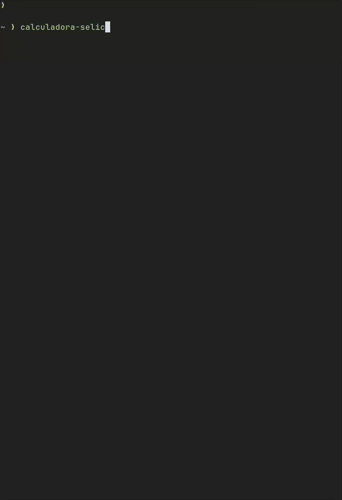

# Calculadora SELIC

Script Bash para consultar e calcular o rendimento acumulado da taxa SELIC em um intervalo de datas, utilizando dados oficiais do Banco Central do Brasil (BCB).

O script utiliza a série SGS 11 (SELIC diária) e gera fatores acumulados para cada mês do período informado.

## Demonstração



## Dependências

- Bash
- Python 3
- Biblioteca Python `requests`
- GNU `date`
- `tput`

No Ubuntu e derivados, instale as dependências com:

```bash
sudo apt install python3 python3-requests
```

## Instalação e execução

Clone o repositório e acesse o diretório:

```bash
git clone https://github.com/SEU-USUARIO/calculadora-selic.git
cd calculadora-selic
```

Conceda permissão de execução e execute o script:

```bash
chmod +x calculadora-selic
./calculadora-selic
```

## Como funciona

O programa solicita duas datas no formato `AAAA-MM-DD`:

- **Data inicial:** primeiro dia do mês inicial.
- **Data final:** último dia do mês final.

Exemplo:

```text
Data inicial: 2023-01-01
Data final:   2023-03-31
```

O script calcula os fatores acumulados para os períodos:

```text
01/01/2023 → 31/03/2023
01/02/2023 → 31/03/2023
01/03/2023 → 31/03/2023
```

Os resultados são organizados em uma única linha, separados por tabulações, no arquivo temporário `tmp_selic_PRONTO.txt`.

**Nota:** os arquivos temporários são removidos ao encerrar o programa. O script usa o comando `open` para tentar abrir o resultado; se não estiver disponível no Linux, substitua por `xdg-open`.

## Fonte dos dados

Os dados são consultados diretamente na [API SGS do Banco Central do Brasil](https://dadosabertos.bcb.gov.br/dataset/11-taxa-de-juros---selic).
